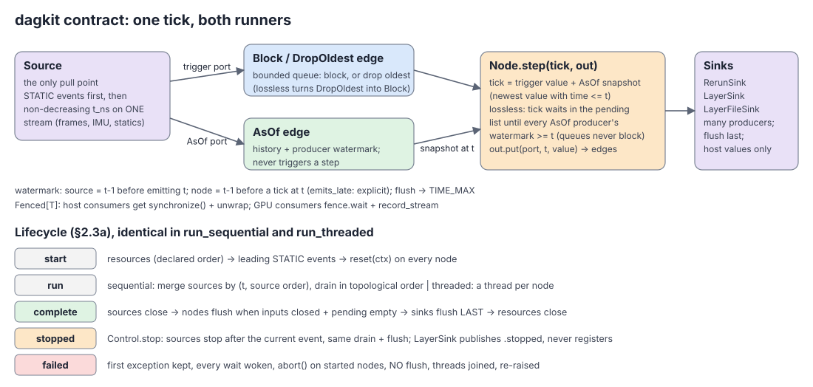
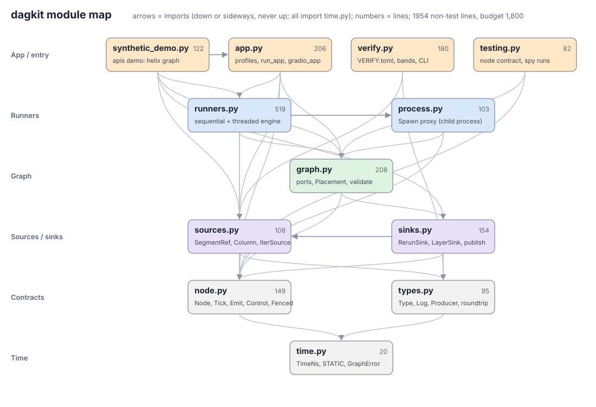

# dagkit

One typed node/graph interface for every pipeline in this repo: Types, push-only Nodes, a declared Graph, two
runners, Sources and Sinks, hardware-class profiles and verify cards. Pure Python; it never imports torch.





## A graph in 20 lines

```python
from dagkit.graph import AsOf, DropOldest, Graph
from dagkit.runners import run_threaded
from dagkit.sinks import RerunSink
from dagkit.sources import IterSource

graph = Graph("demo")
src = graph.source("camera", IterSource({"frame": Frame, "rig": Rig}, read_events))   # one time-ordered stream
det = graph.node("detect", Detector(model))                                          # reset / step / flush
sink = graph.sink("viewer", RerunSink(recording, {"boxes": Boxes}, {"boxes": "/world/boxes"}))
graph.edge(src["frame"], det["frame"], DropOldest(1))   # live: keep the latest frame
graph.edge(src["rig"], det["rig"], AsOf())              # newest rig at or before the frame time
graph.edge(det["boxes"], sink["boxes"])                 # Block(4) by default
report = run_threaded(graph, mode="realtime", health=recording)   # health view at /dagkit/health
```

`run_sequential(graph)` runs the same graph on one thread, deterministically. On Block and AsOf edges both runners
deliver the same ticks to every node (property-tested on random graphs).

## Rules

| Piece | Rule |
|---|---|
| Time | `TimeNs` = i64 nanoseconds on ONE clock per graph; `STATIC` marks whole-stream values |
| Type | `to_rerun(root)`, `contents(root)`, `from_layer(table, root, timeline)`; host Types are `@serde` frozen dataclasses |
| Node | `reset(ctx)` (idempotent), one `step(tick, out)` per trigger event, `flush(out)` at end of stream; models come in through the constructor or `ctx.resources` |
| Ports | `Block` (lossless), `DropOldest` (realtime, counted), `AsOf` (never triggers; lossless waits for the producer watermark) |
| Late output | a node with `emits_late = True` calls `out.watermark(t)`; other nodes' watermark is `t - 1` before a tick at `t` |
| GPU | `Fenced(value, cuda_event)`; host consumers get it synced and unwrapped; never write into a put value |
| Sinks | take an explicit `RecordingStream`; `LayerSink.open(segment, layer, producer, inputs, roots, output_dir=...)` publishes `<layer>.<run_id>.rrd` and registers only if the segment has no such layer (`register="new"`); `Latest(inputs)` hands a graph's newest values to a multi-pass App's next graph |
| Apps | `<module>/apis/<graph>.py` defines `Config` + `build(config, recording) -> Graph` (or a generator of Graphs for a multi-pass app); `main` is `run_app(config, build)` and a verify run drives the same graphs with `run_graphs(config, build, recording)`; `dagkit.form.gradio_app(Config, build, title=...)` generates the UI from the same `build` (the viewer is the `rr_config` field; a `Path` field declares its widget as `field(metadata={"form": "dir"})` or, when optional, `{"form": "save"}`) |
| Graph view | every `run_app` / `gradio_app` run logs the picture (`/dagkit/graph/<graph>`), a guide with links into the data (`/dagkit/guide/<graph>`) and a `GraphDoc` JSON, and colours the boxes with run health; the app wraps its normal blueprint with `with_pipeline(bp, outputs, graphs=...)` for the secondary "pipeline (debug)" tab |
| Docs | a node class's docstring starts with a <= 40-char line saying what it does; port Types have docstrings; `Graph(name, about=...)` |
| Profiles | `profiles/<hardware>.toml` for `x86_64-cuda`, `aarch64-cuda`, `robocap-cap`; never hostnames or GPU models |

## Run

```bash
pixi run -e dagkit-dev --frozen gate                      # lint, typecheck, deadcode, unit + integration tests
pixi run -e dagkit --frozen dagkit-demo                   # synthetic graph into a spawned viewer
pixi run -e dagkit --frozen dagkit-demo --rr-config.connect rerun+http://127.0.0.1:9876/proxy
python -m dagkit.verify packages/<pkg>/VERIFY.toml --phase post   # graph-tier bands (needs DAGKIT_GOLDENS)
```

A card's case `params` keep their TOML types; `case.configure(Record)` builds a package's pyserde params record from the
keys it declares. pre / pre2 goldens are write-once: each run writes its own partial and links it to the golden name.

Tests for a package graph: `dagkit.testing.check_node_contract(node, ticks)` for every node with fakes (it compares runs
through `host` as each output was put, so Fenced values and tensors need no wrapper, and fails a node that writes into an
output after its put), `Collect(inputs)` as a sink that keeps host copies, `dagkit.testing.collect_edges(graph, run)` to compare
`run_sequential` with `run_threaded(mode="lossless")`, `layer_table(values, root)` for a Type's `from_layer(to_rerun)`
round trip without a server, and `check_form(Config, build, widgets, hidden)` for the generated form. For the
graph view, on the graphs the App builds (with fakes): `check_picture(graph, tmp_path)` logs the picture to an rrd and
reads it back (picture == declaration), and `check_graph_docs(*graphs, snapshot=PACKAGE_DIR / "GRAPH.md")` checks the
docs and keeps the package's `GRAPH.md` (the guide without links; `DAGKIT_UPDATE_SNAPSHOTS=1` rewrites it).
