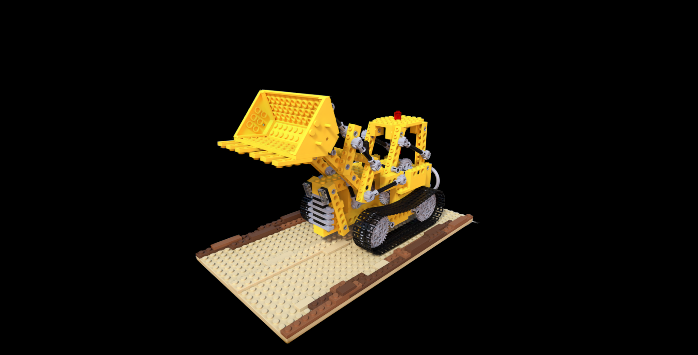
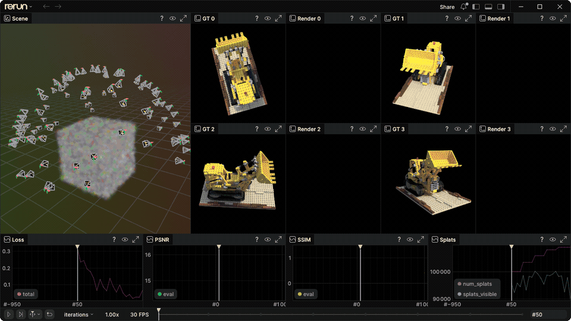

# Gaussian splat renderer

One raw-wgpu core renders PLY scenes in a standalone CLI and native
`GaussianSplats3D` recordings in a custom Rerun viewer. Rust also provides
in-process Brush training, image metrics, and renderer comparisons.
See [architecture](docs/architecture.md) for data boundaries and limitations.

## Build and view

Run tasks from the repository root. Use the prod environment for long runs;
the dev environment adds linting, type checks, and tests.

```bash
pixi run -e gsplat-rust-renderer-dev --frozen gsplat-build
pixi run -e gsplat-rust-renderer --frozen gsplat-download pretrained lego
pixi shell -e gsplat-rust-renderer
cd packages/gsplat-rust-renderer
target/release/gsplat-rust-renderer
```

Activate a Pixi environment once to link the patched `brush-src` tree for Cargo and rust-analyzer; see the bump runbook in [Cargo.toml](Cargo.toml).
In another activated shell, run `python tools/log_gaussian_ply.py --rr-config.connect`.
Pass `--rr-config.headless` when saving a recording without a display.

The custom viewer selects compute rendering automatically. Stock Rerun selects
its native renderer for the same recording. An explicit compute visualizer
selection requires the custom viewer.

Hexel PLYs (planar hexagons, [hexel PLY contract](crates/gsplat-cli/README.md))
enter Rerun as the custom `Hexels3D` archetype (`gsplat_rust_renderer.hexels3d`):
f32 centres, xyzw rotations, two scales, opacity, sharpness, a colour field and
the V2/V3 view term, plus a `Points3D` fallback on the same entity. The custom
viewer draws the hexels with the core's hexel primitive; stock Rerun draws the
fallback points. `tools/log_hexels_compare.py` logs a Brush 3DGS PLY and a hexel
PLY side by side: both views track one orbit camera on the `frame` timeline
(the orbit is fitted to the scene's cameras and also written as `orbit.json`),
with a per-scene metrics table below. `--layout brush|hexels` writes the
one-view recording that `gsplat probe` measures.



## Train

```bash
pixi run -e gsplat-rust-renderer --frozen gsplat-train lego 7000 video
```

The task prepares a deterministic initialization, writes checkpoints and
`training.rrd` under `data/brush-runs/`, and exports every 7,000 steps plus the
final step. Modes are `record`, `live`, and `video`; extra Brush flags follow `--`.
NeRF-synthetic and the COLMAP `truck`/`train` scenes are supported. Direct
`target/release/gsplat-train DATASET` runs without recording unless a sink is set.



## Render, score, and compare

The [CLI reference](crates/gsplat-cli/README.md) owns flags, camera inputs, and scoring conventions.

- `gsplat render`: render a scene from file cameras.
- `gsplat eval`: compare rendered PNGs with ground-truth images.
- `gsplat score`: score a training export against its dataset.
- `gsplat parity`: compare renderers or native archetype quantization.
- `gsplat speed`: compare renderer timings along a camera path.
- `gsplat probe`: measure complete headless viewer frames.

`gsplat-evaluate` runs the published-checkpoint guard; add `--checkpoint-only` to score bundled predictions.

## Measurements

Renderer time per 1080p frame on an RTX 5090, re-measured with an independent driver at `f9c949cc`:
Lego 1.69 ms (Brush 1.97 ms, Rerun 0.38.1 native renderer 13.2 ms);
Garden, 5.2M splats, 4.32 ms (Brush 4.48 ms, native about 294 ms).

In the viewer with a moving eye at `f9c949cc`: Lego 1.88 ms against 13.6 ms in stock Rerun (7.3x);
Garden 7.12 ms against 291 ms (41x).

At training revision `f1dac638`, mean unclipped test PSNR across two scored runs was 32.8540 dB with recording
versus 32.8720 dB for stock Brush.

## Check

```bash
pixi run -e gsplat-rust-renderer-dev --frozen gate
pixi run -e gsplat-rust-renderer-dev --frozen tests-golden
```

The gate includes Rust GPU contracts and headless viewer pixels. Golden tests
cover all camera models, native archetype conversion, and published checkpoints.
Missing datasets produce explicit skips. Run `gsplat-download all all` to obtain
the eight Blender datasets and checkpoints.
