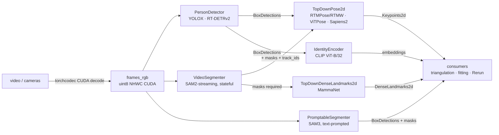
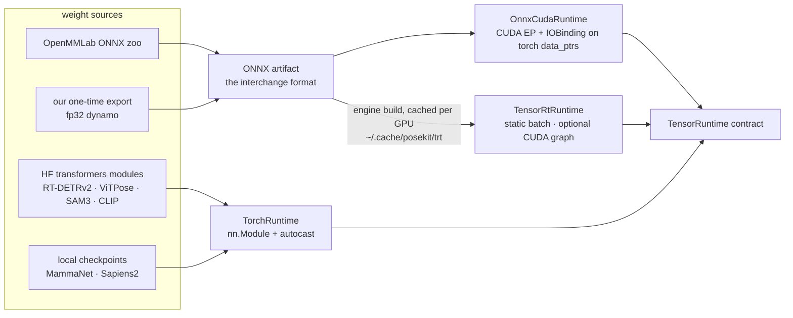

# posekit

One model API for human-centric perception networks — detection, segmentation,
tracking, re-ID, 2D pose, dense landmarks — over **PyTorch, ONNX Runtime, and
TensorRT**, with everything (video decode included) staying on the GPU.

It replaces the five near-copies of bbox→crop math, heatmap/SimCC decoders,
and hand-rolled TensorRT runners that lived in sapiens2-pose (now `posekit.models.sapiens`),
sapiens-coco133-pose, mamma, wilor-nano (now `posekit.models.wilor`), and rtmlib's CPU path.
EgoHand (formerly `packages/egohand`) lives here too; see [Hands](#hands-wilor-and-egohand). So does SAM 3D Body
(formerly `packages/sam3d-body`); see [Whole-body 3D](#whole-body-3d-sam-3d-body).

## How it fits together

Models are grouped into **roles** — the swap points of a pipeline. Every role
consumes the same canonical batch (uint8 RGB NHWC CUDA tensors, straight from
torchcodec's CUDA decoder) and returns GPU-resident predictions:



Any `BoxDetections` producer feeds any top-down consumer — that's what makes
detector, tracker, and pose independently swappable (see `docs/design.md` §2
for why one-stage nets like RTMO/RF-DETR get their own `InstancePose2d` role
instead).

Inside every model class the backend is orthogonal: GPU preprocessing and GPU
decode are shared torch ops, and only the middle — a pure CUDA-tensors-in /
CUDA-tensors-out function — swaps between backends. Weights arrive from three
kinds of sources:



transformers is a **weights source, never a fourth backend**: posekit loads the
`nn.Module` and keeps its own GPU pre/post (the HF image processors are
CPU/PIL-bound).

## Quickstart

Backend choice is config, not code:

```python
from posekit.models import RtmPoseConfig, YoloxDetectorConfig
from posekit.runtimes import TensorRtBackendConfig

detector = YoloxDetectorConfig().setup()
pose = RtmPoseConfig(variant="rtmw-x-coco133", backend=TensorRtBackendConfig()).setup()

detections = detector(frames_rgb)          # uint8 NHWC CUDA in
keypoints = pose(frames_rgb, detections)   # Keypoints2d out, still on GPU
```

Or grab a named preset (`posekit.zoo` — rtmlib's solutions as typed data):

```python
from posekit.zoo import preset
pair = preset("wholebody")   # body / body-performance / wholebody / body-nmsfree / wholebody-fullframe
```

CLI (tyro subcommand unions — model and backend picked per stage):

```bash
# detector backend → pose model → pose backend
pixi run -e posekit --frozen posekit-video-pose --video-path video.mp4 \
    tensorrt rtmpose --variant rtmw-x-coco133 tensorrt

# same demo, transformers-sourced models
pixi run -e posekit --frozen posekit-video-pose --video-path video.mp4 rtdetr vitpose

# detect → SAM2 track → pose → CLIP re-ID, streaming (~38 fps end to end)
pixi run -e posekit --frozen posekit-video-track --video-path video.mp4
```

## Hands (WiLoR and EgoHand)

Two roles cover hands. `HandDetector` maps frames to `HandDetections` (boxes plus a
left/right side per box). `TopDownHandPose3d` maps frames, those detections and an
optional `CalibratedCamera` (`posekit.cameras`, a static `.rrd` via `load_calibrated_camera`) to
`HandPoses3d`: `Keypoints3d` with a hand skeleton, plus per-hand mesh vertices and
per-side faces. `HandPoses3d.as_hand21()` gives every model the same HAND_21 view.

The video CLI and the app take one video and a pinhole camera: `--fx/--fy/--cx/--cy` when you know
them, else a 65° horizontal field of view (`--hfov-deg`) with the principal point at the image
centre. The status line says which was used ("assumed pinhole, f = 1507 px" for a 1920-wide
video). The app's egocentric examples run on the EgoHand stack: GSI head-camera clips
(`assets/examples/gsi_{sewing,workbench}_left_front.mp4`, 1920x1080 pinhole) and Gen-HumanEgo clips
(`assets/examples/genhumanego_{kettle,garlic}.mp4`, 1600x1300, the double-sphere head camera remapped into a
65° pinhole, so the assumed camera is exact), all 6 s or less of plain H.264, and WiLoR's original exocentric demo clip
(`assets/examples/hands_video.mp4`, a person on stage with a microphone) on WiLoR; choosing an
example also selects its stack.

| Model | Detector | 3D hands | Skeleton | Camera | Backends |
|---|---|---|---|---|---|
| WiLoR (`wilor`) | YOLO hand detector | WiLoR ViT + MANO | HAND_21 | predicts in a virtual camera; the video CLI and app move each hand into the pinhole (translation fit to its 2D joints) | torch fp16, TensorRT |
| EgoHand (`egohand`) | RT-DETR hand detector | DINOv3 + SOMA hand head | SOMA_HAND (25) | required (perspective crops undo the lens) | torch, TensorRT backbone/detector |

Both run in the `posekit-hands` environment. EgoHand's upstream source installs from
the pinned recipe `recipes/egohand-src` (patches and licence there) with upstream module
names, because the checkpoint's Hydra targets need them. WiLoR's network lives in
`posekit/models/wilor_net/`.

```bash
# Detect + reconstruct hands on a clip: 2D boxes on the video, 3D joints/meshes in the camera (projected onto the video)
# (default clip: assets/examples/gsi_sewing_left_front.mp4; any --video-path works)
pixi run -e posekit-hands --frozen posekit-video-hands --rr-config.headless --rr-config.save /tmp/hands.rrd \
    wilor tensorrt wilor tensorrt
pixi run -e posekit-hands --frozen posekit-video-hands --rr-config.headless --rr-config.save /tmp/hands.rrd \
    --fx 1507 --fy 1507 --cx 960 --cy 540 egohand onnx egohand   # intrinsics are optional

# The same code as a Gradio app with an embedded Rerun viewer: one video in, stack and intrinsics under Advanced
pixi run -e posekit-hands --frozen posekit-hands-app            # http://127.0.0.1:7872

# Ground-truth eval on fixed frames of five dataforge catalog datasets
pixi run -e posekit-hands --frozen posekit-hands-eval --catalog-url rerun+http://pablo-dl-server:51235 --output-dir /tmp/hands-eval

# Per-frame speed, decoded GPU frame to joints + full mesh, per stage
pixi run -e posekit-hands --frozen posekit-hands-bench
```

Select `egohand-fast` for the fast TensorRT stack on a Blackwell GPU (NVFP4), or
`egohand-fast-bf16` on older GPUs; use the same name for the detector and the pose role:

```bash
pixi run -e posekit-hands --frozen posekit-video-hands --rr-config.headless --rr-config.save /tmp/egohand-fast.rrd \
    egohand-fast tensorrt egohand-fast
pixi run -e posekit-hands --frozen posekit-hands-bench --models egohand egohand-fast
pixi run -e posekit-hands --frozen posekit-hands-eval --models egohand egohand-fast \
    --catalog-url rerun+http://pablo-dl-server:51235 --output-dir /tmp/egohand-eval
```

`fast_egohand_configs()` pairs a batch-one TensorRT detector (PIL-exact GPU resize, its three
encoder input projections in FP8) with an `EgoHandFastConfig`: its `FastEgoHandPredictor` runs
the DINOv3 backbone with the first 8 blocks in NVFP4 and the last 24 in FP8, FP8 attention, BF16
TensorRT heads, captured GPU crops and full per-frame SOMA reconstruction. Identity, all 26
segment scales, joint rotations and every hand vertex remain dynamic. The ordinary `egohand`
selection keeps its original defaults; SelfCap's calibration CLI selects the fast stack with
`--oak-egohand-fast`. `fast_egohand_configs(backbone_precision="bf16")` runs the same executor
unquantized with an FP16 detector. On a GPU without FP8/NVFP4 the default preset raises a
`ValueError` that names the BF16 preset; the choice is explicit, not automatic.

Both roles load committed activation ranges (`assets/egohand_catalog.rrd`,
`assets/egohand_detector_catalog.rrd`): 200 frames / 243 hand crops from one catalog segment per
dataset (UmeTrack, HOT3D Quest 3, SHOW3D, GSI six-view, Gen-HumanEgo), disjoint from the
evaluation segments and checked against every evaluation frame by decoded-RGB SHA256. The
records are frozen artifacts; the calibration contents are part of the export cache key. First
setup exports and builds the missing artifacts through posekit and trtkit.

**Fast-stack speed and accuracy** (1,500 fixed frames: 3 segments × 100 from each of UmeTrack,
HOT3D Quest 3, SHOW3D, GSI six-view and Gen-HumanEgo; batch one, detection on every frame, full
outputs; latency excludes decode and engine builds):

| GPU | `egohand` (reference) | Fast stack | Speed-up | Accuracy bands |
|---|---|---|---|---|
| DGX Spark (GB10), `egohand-fast` | 153.31 ms/frame | 14.98 ms/frame | **10.23x** | 45/45 |
| RTX 3060, `egohand-fast-bf16` | 238.62 ms/frame | 39.24 ms/frame | 6.08x | 45/45 |

A band is one metric on one dataset, relative to the reference: recall, mean IoU and side
accuracy stay ≥ 0.95×; 2D median/p95 pixel error and absolute and wrist-relative 3D median/p95
(mm) stay ≤ 1.05× (nine metrics × five datasets). The 10x is the mean over all frames (UmeTrack
8.5x … Gen-HumanEgo 10.7x). The fixed frames also guided the precision choice. Reproduce with
`hands_eval`'s `end-to-end` protocol; the first command checks the bands, the second (on an
otherwise idle GPU) adds the timing:

```bash
pixi run -e posekit-hands --frozen posekit-hands-eval --catalog-url rerun+http://pablo-dl-server:51235 \
    --models egohand egohand-fast --protocols end-to-end --no-log-rrd --output-dir /tmp/egohand-bands
pixi run -e posekit-hands --frozen posekit-hands-eval --catalog-url rerun+http://pablo-dl-server:51235 \
    --models egohand-fast --protocols end-to-end --no-log-rrd --output-dir /tmp/egohand-speed \
    --timing --baseline /tmp/egohand-bands/results.json   # egohand-fast-bf16 below Blackwell
```

The second command reports the fast stack's latency and fails unless all 45 bands hold against
the first run's `egohand` rows; add `egohand` to its `--models` to time the reference as well.

**Eval protocol** (`posekit.apis.hands_eval`): the frames are fixed in the code
(`posekit.eval.hand_gt.EVAL_SUBSETS`): three segments and one camera per dataset, 100 frames per
segment spread evenly over the frames with a visible hand, read straight from the catalog in one
round trip per dataset. Ground truth is dataforge's `coco133_xyz` (HAND_21 order per side; the
derived joint 1 is not scored) seen through each camera's native lens (pinhole, Fisheye624,
double sphere); a hand counts when its wrist and at least 15 joints are valid. `gt-boxes` crops
1.2x the ground-truth joint box (the paper's protocol); `detector` uses each model's own detector
and scores hands matched at IoU >= 0.3 with the correct side. Their metrics follow the EgoHand
paper (arXiv 2610.30293, Sec. 6.1): MPJPE (wrist-aligned), PA-MPJPE, RTE (root translation,
metric models only) in mm and 2D EPE in px, each as mean / p90. `end-to-end` runs the stack as
deployed and scores the nine banded metrics above. It writes `results.json` and
`hands_eval.rrd` (frames, ground truth next to every prediction, per-frame errors as scalars).

EgoHand, HOT3D, `gt-boxes`, mean (mm / px):

| | MPJPE | PA-MPJPE | RTE | 2D EPE |
|---|---|---|---|---|
| ours (`EVAL_SUBSETS`, RTX 5090) | 20.4 | 8.3 | 29.6 | 10.7 |
| paper, Table 2 (no smoothing) | 18.9 | 9.1 | 36.2 | 16.4 |

The paper does not name its HOT3D split, device or camera, fits SOMA to MANO joints for
ground truth and runs at another image resolution; treat the comparison as a sanity
check, not a reproduction. WiLoR has HOT3D in its training data.

## Whole-body 3D (SAM 3D Body)

`TopDownBodyPose3d` maps frames, person boxes (their optional `masks` act as prompts, weighted by
`scores`) and an optional `CalibratedCamera` to `BodyPoses3d`: MHR-70 joints (`MHR_70`: body, feet, both
21-joint hands) in image pixels and camera metres, the full 18,439-vertex MHR mesh, and the box each row
came from. `Sam3dBodyConfig` (zoo `sam3d-body-dinov3`) fills it with Meta's SAM 3D Body; its
`Sam3dBodyReconstruction` adds the MHR parameters, translation, focal length and the hand crops.
`mode="full"` runs the body pass, a mirrored left-hand and a right-hand pass and merges the hands into the
body (three DINOv3 passes per person); `mode="body"` runs the body pass alone. Without a camera the model
assumes its default field of view. Any `PersonDetector` or the SAM3 `PromptableSegmenter` feeds it.

`Sam3dBodyFastConfig` selects GPU crops, captured inference, compiled MHR and
calibrated TensorRT networks through the same role. See the
[fast-path configuration and validation guide](docs/sam3d-body-fast.md).

The upstream inference source (`sam_3d_body`) installs from the pinned recipe `recipes/sam-3d-body-src`
(patches and SAM License there); its DINOv3 comes from `recipes/dinov3-src`. The checkpoint `facebook/sam-3d-body-dinov3` is gated: request access,
then `hf auth login`. The model needs the `posekit-sam3d-body` feature; the apps run in `posekit-body`
(MoGe-2 camera and depth through monopriors, Open3D).

```bash
# Images (default: the four examples) or a video; SAM3 masks + MoGe-2 camera + SAM 3D Body -> Rerun
pixi run -e posekit-body --frozen posekit-body3d --rr-config.headless --rr-config.save /tmp/body3d.rrd
pixi run -e posekit-body --frozen posekit-body3d --video-path assets/examples/hands_video.mp4 --max-frames 48

# Gradio app with an embedded Rerun viewer, http://127.0.0.1:7871
pixi run -e posekit-body --frozen posekit-body3d-app

# Multiview demos on the HO-Cap sample (downloaded on first run, ~1.7 GB)
pixi run -e posekit-body --frozen posekit-body3d-mv-video     # SAM3 video masks + TSDF fusion
pixi run -e posekit-body --frozen posekit-body3d-mv-body      # per-camera bodies fused by MHR reprojection

# Per-frame speed (decoded GPU frame + person box -> full output), body and full mode, per stage
pixi run -e posekit-body --frozen posekit-body-bench
```

| `packages/sam3d-body` task (`-e sam3d-body`) | posekit task (`-e posekit-body`) |
|---|---|
| `sam3d-body-app` | `posekit-body3d-app` |
| `sam3d-body-cli` | `posekit-body3d` (also `--video-path`) |
| `sam3d-body-download-hocap-sample` | `posekit-body-download-hocap-sample` (to `data/hocap/sample`) |
| `sam3d-body-mv-video-demo` | `posekit-body3d-mv-video` |
| `sam3d-body-mv-body-demo` | `posekit-body3d-mv-body` |
| (none; images were not downloadable) | `posekit-body-download-examples` |

`tool/demo_mv_image.py` (no task; SAM3-only multiview segmentation of one frame) and
`tool/new_gradio_sam3.py` (it launched `packages/sam3`'s own UI) were not moved.

Goldens: `tests/test_body_golden.py` checks the role against references on the NAS
(`posekit/goldens/sam3d-body-v1`, README there). Full-mode outputs depend on earlier calls in the
process (a model's first full-mode call differs from later ones by up to 0.2 mm; other shapes and inputs
move later calls by up to ~1 mm), so full-mode tolerances are a few millimetres; body mode agrees to 1e-6.

## Click-to-track app (SAM2 + Rerun)

A Gradio app for single-object video segmentation: upload a clip, click the object in
the embedded Rerun viewer, refine on any frame, and propagate the mask through the clip.

```bash
pixi run -e posekit --frozen posekit-track-app            # http://127.0.0.1:7870
pixi run -e posekit --frozen posekit-track-app --port 7870 --variant efficienttam-s-512
```

The embedded viewer needs a secure context; on the tailnet expose it with
`tailscale serve --bg --https=7870 http://127.0.0.1:7870` and open
`https://<host>.<tailnet>.ts.net:7870/` (served at `/`, so `--root-path` stays empty).
Run it in a shell without `DISPLAY`: the app never spawns a native viewer.

Using it:

- **Click** the object in the viewer at the current frame (`+ Include`); `− Exclude` and
  `✕ Remove` add negative points / delete the nearest point. Pause the viewer before
  clicking — while it plays the click's frame is unknown. Scrubbing shows a memory-conditioned
  preview of the current mask.
- **Track** propagates from the first prompted frame forward, then backward to frame 0, and
  streams masks plus per-frame confidence traces. Clicking again after a track refines it;
  Track re-runs from the kept prompts.
- **Config** tab: model (`efficienttam-s-512` default, `-ti-512` faster), SAM2 memory window,
  point-removal radius, and "re-segment" (clicks replace the object instead of refining it).
  Model and memory window reload the clip and clear the points.
- **Outputs** tab: after a track, download a self-contained `.rrd` (video, prompts, masks,
  confidence). Masks are logged at 1/4 resolution under a `Transform3D(scale=4)` on
  both `video/mask` and `video/preview`; apply it when reading them back.

H.264 input passes through unchanged. HEVC input in MP4 or MOV is transcoded to H.264,
using the GPU when available, so browsers can decode it. Other codecs depend on Rerun
`Mp4Reader` support; MPEG-4 Part 2 (`mp4v`) is not supported and fails at load.

## What runs today, and how well

Every implementation is parity-validated against its reference:

| Model | Role | Backends | Validated vs | Result |
| --- | --- | --- | --- | --- |
| YOLOX (HumanArt) | `PersonDetector` | onnx · trt | rtmlib | boxes ≤ 4 px |
| RT-DETRv2 | `PersonDetector` | torch | HF processor | ≤ 0.31 px |
| RTMPose / RTMW | `TopDownPose2d` | onnx · trt | rtmlib | 1.3 px mean |
| ViTPose | `TopDownPose2d` | torch | HF processor | 0.75 px mean |
| Sapiens2 pose | `TopDownPose2d` | trt (default); torch · onnx · trt (`bf16-1024`) | bf16-1024 (d31, 2026-10-31); pre-port goldens | PCK@0.01 body/hands 0.911/0.971 (NVFP4); port bit-identical |
| SAM3 | `PromptableSegmenter` | torch | HF processor | mask IoU ≥ 0.997 |
| SAM2/EfficientTAM | `VideoSegmenter` | torch | — | stable 30-frame track, IoU ≥ 0.97 |
| CLIP ViT-B/32 | `IdentityEncoder` | torch | PIL pipeline | cosine ≥ 0.985 |
| MammaNet (in mamma) | `TopDownDenseLandmarks2d` | torch | mamma estimator | bitwise-equal |
| SAM 3D Body | `TopDownBodyPose3d` | torch | pre-port package | bitwise in its env; 3x run-to-run noise here |

Adoption: **mv-api**'s `MultiviewBodyTracker` runs on posekit roles (batched
per tick, 0.3–0.6 px vs its old rtmlib path, roles injectable via
`detector=`/`pose=`); **mamma** provides the MammaNet role adapter
(`mamma.landmarks.posekit_role`). Per-milestone numbers:
[`docs/implementation-notes.html`](docs/implementation-notes.html); full
inventory, paradigm taxonomy, and roadmap: [`docs/design.md`](docs/design.md).

## Predictions

Flattened across the frame batch with `frame_indices`, on the inference device,
numpy only at the Rerun/serialization boundary (`xy_numpy()`):

- `BoxDetections` — `xyxy`, `scores` (+ optional `masks`, `track_ids`) — one
  type for detector, tracker, and segmenter output.
- `Keypoints2d` — `xy`, `scores`, and its `KeypointSkeleton` (+ optional
  `uncertainty`), so consumers never guess what index 17 means.
- `DenseLandmarks2d` — xy + log-variance + visibility + contact heads.
- `Keypoints3d` — sparse 3D (image xy + root-relative z), for Phase 4.

## Gotchas

- **MMDeploy detector zips** bake `TopK(k=5000)`+NMS (batch-1 only, TRT rejects
  K > 3840). `artifacts.strip_detector_nms` cuts the graph before the TopK
  cluster; thresholding + torchvision NMS run on GPU instead.
- **Sapiens2 defaults to `nvfp4-768`**, a 768×576 TensorRT 0.4B engine with
  NVFP4 backbone linears, FP8 attention and head, and a dynamic 1/4/8 batch profile.
  Scores remain raw heatmap maxima. On the RTX 5090 d31 four-rig evaluation
  (2,880 people), it took 5.643 ms/person end-to-end versus 31.85 ms for the
  original engine; keep-agreement at 0.7 was 0.9807.
  Use `SapiensPoseConfig(variant="bf16-1024", backend=...)` for the original
  1024×768 path, including Torch and ONNX backends or larger checkpoints.
  Fast export caches include the calibration hash and export version.
  Regenerate ranges from person crop images with
  `pixi run -e posekit posekit-sapiens-calibrate --crops-dir <dir> --output <rrd>`,
  then review the .rrd before replacing `src/posekit/models/sapiens_net/fast_pose_768.rrd`.
  Sapiens fp16 TensorRT overflows; the original TensorRT path uses bf16.
- **Export outside dev mode** (`-e posekit`, not `-e posekit-dev`):
  `torch.onnx.export` tracing violates beartype hints in instrumented packages.
- **Compare pose backends on confident keypoints only** (score > 0.3) —
  low-confidence argmax noise inflates pixel errors ~100×.

## Adding a network

1. **Weights** — zoo ONNX (`fetch_openmmlab_onnx`), HF `from_pretrained`
   module, or a one-time fp32 dynamo export.
2. **Crops** — a `CropSpec` (size, `udp`/`cv2` align, BGR flag, mean/std);
   `ops.crops.crop_frames` does the batched `grid_sample` on GPU.
3. **Decode** — `decode_udp_heatmaps`, `decode_classic_heatmaps`,
   `decode_simcc`, or a new GPU decoder in `ops/`.
4. **Model class** — config dataclass with `setup()` implementing the matching
   role ABC; register it in the `posekit.models` tyro union and `posekit.zoo`.
