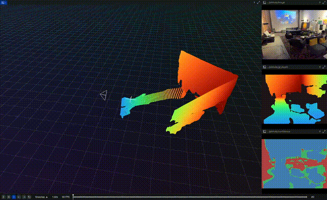

# Simple CV
Utility Computer Vision functions that I often use
<p align="center">
  
</p>

## Install
This package lives inside the examples monorepo. From the repository root:
```bash
pixi run -e simplecv-dev --frozen tests
```

With direnv enabled, `cd packages/simplecv` activates `simplecv-dev`.

## Run Examples
### See all avaiable tasks
```bash
pixi task list -e simplecv
```

### Rerun Environment
The standard `simplecv` environment uses the released conda-forge `rerun-sdk`
pinned in the root `pixi.toml`, with the PyPI `catalog` extra spelled out beside it.

The catalog runs on the `simplecv-catalog` environment, which also gets the
`dataloader` extra's packages through the shared `rerun-prerelease` feature. It currently uses the same release as the rest of the workspace. See
the root `AGENTS.md` "Testing Rerun builds" section for how to test an
unreleased build.

Dataset conversion, registration and download live in `packages/dataforge` (`dataforge.apis.convert`, `register`, `download`).

### Ingest Exo/Ego Recordings
Ingest synchronized exo/ego captures into Rerun (spawns the viewer unless told otherwise).
```bash
simplecv-ingest-exoego --exoego-dir data/exoego-examples/adil-correct/adil3/
```

#### Handy flags
- `--reencode-to-av1` ensures every clip is resized to ≤720p and re-encoded to AV1 MP4 before logging.
- `--rr-config.headless` disables the Rerun UI (useful for automated runs).
- `--rr-config.connect` or `--rr-config.serve` reuse an external/remote Rerun viewer.

The CLI is Tyro-based, so tab completion and `--help` are available by default.

### Video Decode Format Tradeoffs
For the current TorchCodec CUDA default, benchmark summary, and fallback checks, see [docs/video_decode_format_tradeoffs.md](docs/video_decode_format_tradeoffs.md).

### Batch Processing ExoEgo from S3

Process multiple ExoEgo sequences from S3 in batch. The pipeline downloads, cuts, and optionally ingests recordings.

**Environments:**
- Use `simplecv` for NVENC AV1 encoding (requires RTX 40+ GPU)
- Never use `simplecv-dev` for batch (beartype slows processing)

**Cut Only (download + cut videos):**
```bash
pixi run -e simplecv --frozen python tools/exoego_tools/batch_process_s3.py \
    --s3-bucket YOUR_BUCKET_ID \
    --profile YOUR_AWS_PROFILE \
    --output-dir /path/to/output \
    --parallel-workers 4 \
    --cut-only
```

**Full Pipeline (cut + ingest to RRD):**
```bash
pixi run -e simplecv --frozen python tools/exoego_tools/batch_process_s3.py \
    --s3-bucket YOUR_BUCKET_ID \
    --profile YOUR_AWS_PROFILE \
    --output-dir /path/to/output \
    --parallel-workers 4
```

**Re-ingest Only (regenerate RRDs from cut data):**
```bash
pixi run -e simplecv --frozen python tools/exoego_tools/batch_process_s3.py \
    --s3-bucket YOUR_BUCKET_ID \
    --profile YOUR_AWS_PROFILE \
    --output-dir /path/to/output \
    --reingest-only
```

**State Management:**
- Progress tracked in `manifest.json` in output directory
- Ctrl+C is safe - restart resumes from last checkpoint
- Completed sequences are skipped on restart


## Notation for Transformation Matrices

__TL;DR:__ `world_T_cam == world_from_cam`  
This repo uses the notation "cam_T_world" to denote a transformation from world to camera points (extrinsics). The intention is to make it so that the coordinate frame names would match on either side of the variable when used in multiplication from *right to left*:

    cam_points = cam_T_world @ world_points

`world_T_cam` denotes camera pose (from cam to world coords). `ref_T_src` denotes a transformation from a source to a reference view.  
Finally this notation allows for representing both rotations and translations such as: `world_R_cam` and `world_t_cam`
