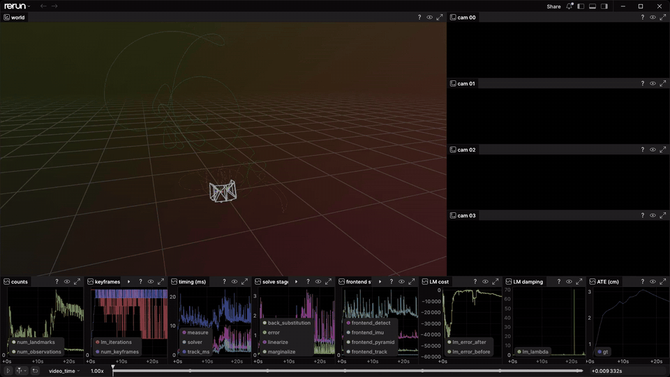
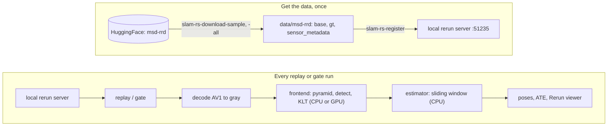
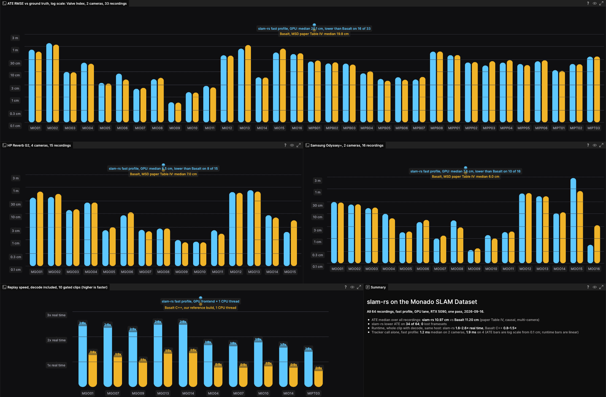
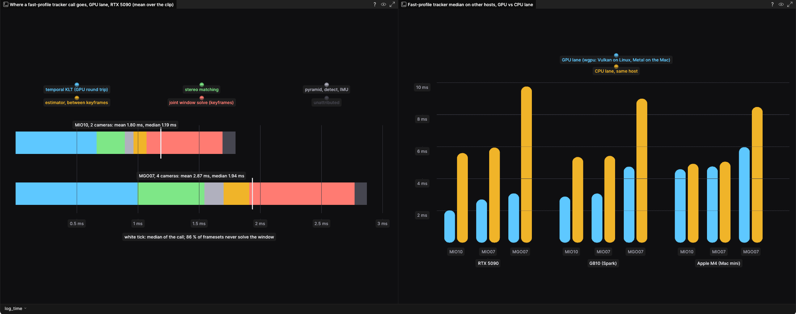

# slam-rs

<p align="center">
  
</p>

Visual-inertial odometry in Rust: any number of cameras, a CPU frontend and a
portable GPU frontend through CubeCL and wgpu (Vulkan, Metal, DX12), driven from
Python through a PyO3 module. It reads Rerun recordings from a local Rerun
catalog and draws its estimate against ground truth in the viewer. Runs on
Linux x86-64, Linux aarch64 and macOS arm64.

## Quickstart

```bash
git clone https://github.com/rerun-io/examples-monorepo.git
cd examples-monorepo/packages/slam-rs
pixi run -e slam-rs slam-rs-demo
```

One command: it builds the core with its GPU frontend (a few minutes the first time), fetches
three short recordings of the
[Monado SLAM Dataset](https://huggingface.co/datasets/pablovela5620/msd-rrd)
(about 50 MB), starts a local Rerun catalog, registers them, and opens the
four-camera G2 clip from the gif above in the viewer, the estimate drawn
against ground truth. The terminal prints the ATE when the clip ends. You need
[pixi](https://pixi.sh), a screen, and Linux. The catalog stays running for
the next run.

Every slam-rs tool runs the frontend on the GPU by default. With no backend flag
(`--backend auto`) it uses the GPU frontend when the host has a Vulkan or Metal
adapter that passes the subgroup check; otherwise it runs on the CPU and prints
one warning that names the reason. `--backend cpu` forces the CPU lane;
`--backend gpu` fails instead of falling back. The estimator always runs on the CPU.

Then, when you want more:

```bash
pixi run -e slam-rs slam-rs-gate --tier smoke      # score the two short smoke clips against the checked-in baselines
pixi run -e slam-rs slam-rs-download-all           # all 64 recordings, 15.5 GB
pixi run -e slam-rs slam-rs-register               # picks up the new files; idempotent
pixi run -e slam-rs slam-rs-gate --tier release    # three longer clips; --tier listed scores the other five
pixi run -e slam-rs slam-rs-gate --backend cpu     # the same clips on the CPU lane
pixi run -e slam-rs slam-rs-replay --stage vio --segment <id>                     # any segment in the viewer
pixi run -e slam-rs-cuda slam-rs-catalog-layer --segment <id> --output-dir <dir>   # a catalog segment's slam_rs layer
pixi run -e slam-rs slam-rs-replay --stage vio --rrd base.rrd --gt-rrd gt.rrd     # your own recording, no catalog
pixi run -e slam-rs slam-rs-replay --stage vio --rrd base.rrd --mask-entity people_mask --mask-rrd masks.rrd  # no features on masked pixels
```

Segmentation masks (people, the operator, a selfie stick) keep the frontend off moving pixels. The mask layer has, per
camera, a `SegmentationImage` at `<camera>/pinhole/<name>` (nonzero = masked) at the resolution it was computed at,
with a static `Transform3D(scale=[W_img / W_mask, H_img / H_mask, 1])` on the same entity; masks may be sparser than
the video, and each frame takes the latest one at or before it (`slam_rs.frame_masks`). colsfm reads the same layer for
its keypoint masks. The frontend neither detects in nor keeps a track in a detection cell that holds a masked pixel
(Basalt's per-frame `img->masks`). Without `--mask-entity` nothing changes.

Every task builds the core first, so no manual build step is needed. Decoding
follows the same rule as the frontend: NVDEC when CUDA is available, otherwise
the CPU decoder (PyAV with dav1d). Only the `slam-rs-cuda` environment carries
the CUDA torch stack for NVDEC; the `slam-rs` environment stays small and
portable (Linux x86-64 and aarch64 without CUDA, and `slam-rs-osx` on macOS), so
it decodes on the CPU and says so once. Two measurements always decode on the
CPU: the gate, whose baselines are frozen on the single-threaded dav1d path, and
the RoboCap fleet rows, which compare machines and so need the same pixels on
every machine.

The gate prints the ATE beside the baseline and pass or fail; on a host that
recorded no baseline the speed clause is reported, not gated. `slam-rs-serve`
starts the catalog by hand in its own terminal; registrations live in memory,
so register again after a restart. On macOS use `-e slam-rs-osx`: the core,
the GPU frontend and the `--rrd` replay work there, the catalog step does not,
because registration goes through dataforge, which is Linux only. More in
[docs/reproduce.md](docs/reproduce.md).



The catalog serves the encoded video and the sensor streams; slam-rs decodes
them itself and the estimator only ever sees grayscale framesets and IMU samples.

### Use slam-rs from another repo

The package is a pixi-build source dependency with two outputs. A Vio-only consumer needs the core:

```toml
[workspace]
preview = ["pixi-build"]

[dependencies]
python = "3.12.*"
slam-rs = { git = "https://github.com/rerun-io/examples-monorepo", subdirectory = "packages/slam-rs" }
```

`pixi install` compiles the Rust core once per checkout (about a minute on a workstation) and installs
`slam_rs` with `_core`, `rig`, `frontend_log`, `config` and `machine`, which import only numpy,
jaxtyping, pyserde and rerun-sdk (0.42.0, from conda-forge). Add `slam-rs-catalog` from the same source for the
catalog readers, `tracking`, `vio_log`, `trajectory`, `reference` and the tyro apis; that output expects
`simplecv` and `dataforge` from your workspace, as this monorepo supplies them through `catalog-common`.
Pin a commit with `rev = "<sha>"` once you depend on it.

## Results

<p align="center">
  
</p>

Every recording of the Monado SLAM Dataset, one pass on 2026-09-16 with the fast
profile and the GPU frontend on an RTX 5090. ATE is RMSE in centimetres against
the catalog ground truth after rigid alignment. The Basalt column is the MSD
paper's Table IV (causal, multi-camera, CPU): a reference point, not a paired run.

Measured 2026-09-16 on `215ad203`, core `40c7ab243c22`, decode `cpu_gray8_dav1d_1thread`.

| dataset | recordings | slam-rs median ATE cm | Basalt (paper) median ATE cm | lost framesets | slam-rs lower on |
|---|---:|---:|---:|---:|---:|
| msd-index | 33 | 20.14 | 19.80 | 0 | 16 / 33 |
| msd-g2 | 15 | 8.53 | 7.00 | 0 | 8 / 15 |
| msd-odyssey | 16 | 7.57 | 6.05 | 0 | 10 / 16 |
| all | 64 | 10.97 | 11.20 | 0 | 34 / 64 |

Per-recording numbers, the reference profile and other hosts:
[docs/benchmarks.md](docs/benchmarks.md).

## Where the time goes

<p align="center">
  
</p>

The fast profile is bimodal. The 86 % of framesets between keyframes cost about
1.2 ms on two cameras and 1.9 ms on four, and that floor is the GPU round trip
of the KLT step. The 14 % keyframe framesets pay the joint window solve on the
CPU, which is what lifts the mean and the tail. A full replay from the catalog
is decode-bound: three quarters of its time is AV1 decoding, under a fifth is
the tracker.

Under pytest, beartype checks the two annotated frame locals in
`SegmentFeed.framesets` (`image`, `current`) on every decoded frame, which
doubles the `slam-rs-dev` gate (about 63 s instead of 31 s). Time runs outside
pytest, which never load beartype. If the gate time starts to matter, drop
those two annotations.

## Two profiles and two lanes

The **fast profile**, the default, detects only when camera 0 has lost 15 % of
its keypoints and solves the whole sliding window at keyframes, the newest
state alone in between. KLT stops each level when its update is below 0.05 pixels.
`--profile reference` runs the unmodified dataset configuration.

The **GPU lane** runs the frontend as CubeCL kernels through wgpu, and it is
the default: every tool asks `slam_rs::select_backend` (the Rust CLI directly,
the Python tools through `slam_rs._core`) and gets the GPU when the host can run
it. `--backend cpu` selects the **CPU lane**. The GPU lane's estimator runs on
one CPU thread; the CPU lane can use its work pool. Both lanes are checked
against the same trajectory accuracy gates, each against its own baselines.
The core crate keeps the `gpu-wgpu` cargo feature off by default, so wasm, iOS
and embedded builds stay CPU-only; the pixi build task, the Python package and
the CLI builds turn it on.
The design decisions are listed in
[docs/design-notes.md](docs/design-notes.md#decision-references).

The GPU lane uses fused KLT on every device. Each point uses 16 subgroup
lanes; larger power-of-two subgroups hold multiple point groups. Startup
checks the required subgroup operations; if they are unsupported, `auto`
runs the CPU lane with one warning and `--backend gpu` fails with the reason. Templates stay in registers and both
tracking directions run in one launch per phase. The fast profile's exit
threshold works on both lanes.
Replay summaries count frames using one-wait, lookahead and packed uploads.

## Data

The library reads one thing: a recording in the `exoego:v2` rig schema. One base
`.rrd` per sequence carries the rig calibration, one video stream per camera and
the IMU stream; ground truth and results are separate layers on the same entity
paths, stacked by the catalog under one recording id. In code the contract is
three calls: `Calibration` is the rig, `Vio.push_imu` takes one IMU sample,
`Vio.track` takes one synchronized frameset and returns a pose.

## Going further

- [docs/design-notes.md](docs/design-notes.md): the core modules, the Python
  API, the reference set and gates, the patched dependencies, and every recorded
  decision.
- [docs/benchmarks.md](docs/benchmarks.md): every recording, the reference profile,
  cuVSLAM, other hosts.
- [docs/reproduce.md](docs/reproduce.md): the full dataset, the release gate, your
  own catalog, and how the recordings were converted.
